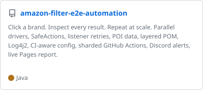
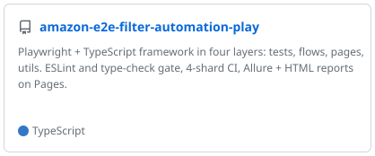
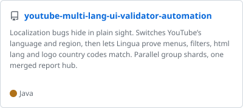
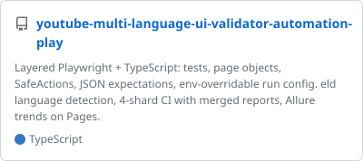

## Hi, I'm Sagar 👋

Test Engineer building scalable automation frameworks and reliable test systems for web and multi-platform apps.

🛠 **Stack:** Java · TypeScript · Selenium · Playwright · TestNG · REST Assured · GitHub Actions

[🌐 Portfolio](https://sagarjhathi.github.io/portfolio2.0/) · [💼 LinkedIn](https://www.linkedin.com/in/sagar-hathi-a72054241/)

### Featured projects

<!-- PINNED:START -->

<a href="https://github.com/sagarjhathi/amazon-filter-e2e-automation"><picture>
<source media="(prefers-color-scheme: dark)" srcset="assets/amazon-filter-e2e-automation-dark.svg">
<source media="(prefers-color-scheme: light)" srcset="assets/amazon-filter-e2e-automation-light.svg">

</picture></a>
<a href="https://github.com/sagarjhathi/amazon-e2e-filter-automation-play"><picture>
<source media="(prefers-color-scheme: dark)" srcset="assets/amazon-e2e-filter-automation-play-dark.svg">
<source media="(prefers-color-scheme: light)" srcset="assets/amazon-e2e-filter-automation-play-light.svg">

</picture></a>
<a href="https://github.com/sagarjhathi/youtube-multi-lang-ui-validator-automation"><picture>
<source media="(prefers-color-scheme: dark)" srcset="assets/youtube-multi-lang-ui-validator-automation-dark.svg">
<source media="(prefers-color-scheme: light)" srcset="assets/youtube-multi-lang-ui-validator-automation-light.svg">

</picture></a>
<a href="https://github.com/sagarjhathi/youtube-multi-language-ui-validator-automation-play"><picture>
<source media="(prefers-color-scheme: dark)" srcset="assets/youtube-multi-language-ui-validator-automation-play-dark.svg">
<source media="(prefers-color-scheme: light)" srcset="assets/youtube-multi-language-ui-validator-automation-play-light.svg">

</picture></a>

<!-- PINNED:END -->
