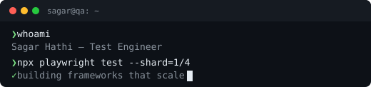

<table width="90%">
<tr>
<td width="58%" valign="middle">

</td>
<td width="42%" valign="middle">

Each pinned project is built twice: **Selenium + Java** and **Playwright + TypeScript**, with sharded CI and live reports. 
[Portfolio](https://sagarjhathi.github.io/portfolio2.0/) · [LinkedIn](https://www.linkedin.com/in/sagar-hathi-a72054241/)

</td>
</tr>
</table>

